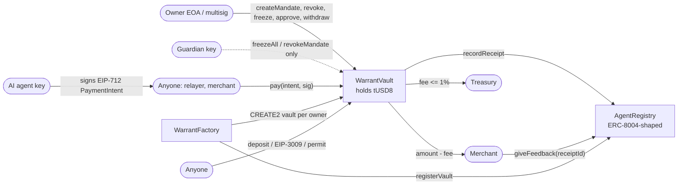

# Warrant

**Spending mandates for AI agents, on stablecoins.** Give an agent a *mandate* instead of a wallet key:
a signed, capped, expiring, revocable permission to pay specific merchants in tUSD8, with every decision
written on-chain. Built for the [Aevum Builder Challenge #1](https://dorahacks.io/hackathon/qday/detail)
on QDay Aevum testnet (chain `44005`).

> Status: **Phase 1 (contracts + tests) done. Not deployed yet.** The addresses table below is filled in at
> deployment. Web UI, SDK and demo agent come in later phases.

## Why

An agent that can sign transactions can be prompt-injected, leaked or just wrong. Today you either hand it
a hot wallet (unbounded loss) or approve every payment (no autonomy). Warrant sits in between:

| Risk | Control in Warrant |
|---|---|
| Agent key leaks | Mandate caps (per tx / per day / lifetime), merchant allowlist, expiry, instant revoke. The key never touches funds directly. |
| Prompt injection ("pay 0xEvil") | Unlisted merchant is rejected on-chain, whatever the agent signs. |
| Runaway loop / retries | `invoiceRef` idempotency: a merchant invoice can be paid once. Single-use nonces. |
| Big-ticket payments | Co-sign threshold: payments at or above it wait in a queue for the owner. |
| Compromised relayer | Intents are EIP-712 signed by the agent; a relayer can't change merchant, amount or invoice. |
| Panic | `freezeAll()` by owner or guardian; only the owner can unfreeze. Guardian can never move funds. |
| "What did the agent do and why?" | Every payment emits `PaymentExecuted` with the agent's `intentHash` (hash of its prompt/context). |

## Architecture



### Contracts (`src/`)

| Contract | What it does |
|---|---|
| `WarrantVault` | One per user. Holds tUSD8. Mandates (agent, per-tx / period / total caps, merchant allowlist with optional per-merchant caps, `validAfter`/`expiry`, co-sign threshold + approval window), EIP-712 `PaymentIntent` payments relayable by anyone, pending queue, `check()` with reason codes, revoke, freeze, guardian, gasless deposits (EIP-3009 `receiveWithAuthorization` and EIP-2612 `permit`), audit events. |
| `WarrantFactory` | Deploys one vault per owner at a predictable CREATE2 address, registers it with the registry, holds the optional protocol fee (**hard cap 1%**, charged to the merchant, never to the user). Two-step ownership. |
| `AgentRegistry` | ERC-8004-shaped identity (ERC-721 per agent, `agentURI`, metadata, signature-verified `agentWallet`) plus **receipt-bound feedback**: only a merchant that was actually paid by the agent through a vault can rate it, once per payment. Not the official registry (see below). |

Design details, reason codes and threat model: [`docs/DESIGN.md`](docs/DESIGN.md).

### Payment lifecycle

1. Owner funds the vault (`deposit`, or gasless `depositWithAuthorization` / `depositWithPermit`) and calls
   `createMandate(params, merchants, rules)` for the agent's key (and optionally its registry `agentId`).
2. Agent signs `PaymentIntent{mandateId, merchant, amount, invoiceRef, intentHash, nonce, deadline}`.
   The agent needs no gas and no balance.
3. Anyone submits `pay(intent, signature)`. The vault checks mandate state, expiry, caps, merchant, invoice
   uniqueness, nonce, signature and balance. Result is one of:
   - `Ok`: tUSD8 moves to the merchant (minus fee), `PaymentExecuted` is emitted, a receipt is recorded.
   - `ApprovalRequired`: queued (`PaymentQueued`); the owner calls `approve(id)` or signs `approveBySig`.
     Approval re-validates everything *now* (revoked, frozen, expired, caps, balance).
   - revert `PaymentRejected(reason)`: nothing is booked, nothing is burned; the signed intent stays usable
     if the reason was transient.
4. `check(intent, sig)` is a never-reverting dry run that returns the same `Reason`, for UIs and agents.

## Aevum specifics handled

- **Shanghai EVM**: `evm_version = "shanghai"`; no `MCOPY`/`TSTORE`/`TLOAD`/blob ops (a test scans the runtime
  bytecode of all contracts for them). No OpenZeppelin `*Transient` contracts.
- tUSD8 is a 6-decimals USDC-style token with EIP-2612 and EIP-3009 (domain `name="tUSD8"`, `version="2"`);
  fork tests sign against the real domain.
- Legacy (type 0) transactions: `forge script ... --legacy`. `eth_getLogs` is limited to 1,000 blocks.
- No official ERC-4337 bundler/paymaster and ERC-8004 registry are open for the challenge. Warrant needs
  neither: gasless payments are relayed EIP-712 intents and gasless deposits use EIP-3009/permit.

## Setup

Requirements: [Foundry](https://book.getfoundry.sh/getting-started/installation) (`foundryup`), git.

```bash
git clone --recursive <repo-url> warrant && cd warrant
forge build
forge test                      # 145 tests incl. fork tests against real tUSD8 on https://rpc-test.qday.info
forge test --no-match-path "test/fork/*"   # offline
forge test --gas-report
forge coverage --no-match-path "test/fork/*" --report summary
```

### Environment variables

| Variable | Used by | Meaning |
|---|---|---|
| `DEPLOYER_PRIVATE_KEY` | `script/Deploy.s.sol` | **Testnet-only** key that deploys (required for deploy). Put it in `.env` (gitignored). |
| `TUSD8` | deploy | Stablecoin address. Default `0x456569838f1d43009A91ebA4263147Afd7233483`. |
| `TREASURY` | deploy | Fee recipient. Default: deployer. |
| `FEE_BPS` | deploy | Protocol fee in basis points, default `10` (0.10%), hard cap `100`. |
| `AEVUM_RPC_URL` | fork tests | Override the RPC (default `https://rpc-test.qday.info`). Fork tests skip if unreachable. |

### Deploy (Aevum testnet)

```bash
cp .env.example .env            # then set DEPLOYER_PRIVATE_KEY (testnet-only!) and fund it at https://faucet.qday.info
make deploy-dry                 # simulation
make deploy-aevum               # broadcast: registry, factory, wiring (about 10M gas)
```

## Testnet deployment

| Contract | Address | Explorer |
|---|---|---|
| tUSD8 (existing) | `0x456569838f1d43009A91ebA4263147Afd7233483` | [link](https://explorer-test.qday.info/address/0x456569838f1d43009A91ebA4263147Afd7233483) |
| AgentRegistry | _not deployed yet_ | |
| WarrantFactory | _not deployed yet_ | |

Source verification: the explorer's Blockscout verifier is reported as not working yet by the organizers;
verification will be attempted after deployment and otherwise this README will link the exact commit,
standard-input JSON and a bytecode-match script.

## Tests

| Suite | What it proves |
|---|---|
| `VaultMandates` | Mandate validation (nested caps, bounded lifetime, merchant list, identity binding), merchant rules, revoke (owner/guardian), freeze, guardian powers, nonce invalidation. |
| `VaultPayments` | Every `Reason`; cap edges; fixed-window reset; per-merchant caps; expiry/validAfter edges; signature binding to vault + every field; ERC-1271 agents; replay, invoice idempotency; fee math. |
| `VaultApproval` | Co-sign queue, approve / `approveBySig`, reject, expire, re-validation at approval time. |
| `VaultFunding` | Allowance, EIP-3009 and permit deposits (incl. front-run permit), withdraw, rescue, reentrancy attempt from a token callback. |
| `Factory`, `AgentRegistry` | CREATE2 prediction, fee cap, two-step ownership, identity/wallet proofs, receipts, receipt-bound feedback, self-dealing block, fuzzed summary math. |
| `VaultFuzzInvariant` | `check` predicts `pay`; unlisted merchants and foreign keys never authorised; fee ≤ 1%; invariants: spend ≤ total/period caps, books equal balances under random pay/warp/freeze/withdraw. |
| `ShanghaiOpcodes` | No post-Shanghai opcodes in deployed bytecode. |
| `fork/AevumFork` | Real tUSD8 on a fork of Aevum: token facts, EIP-3009 + permit deposits, full story (mandate, fee, injection attempt, co-sign by signature, feedback, revoke, withdraw). |
| `Deploy`, `GasProfile` | Deploy script wiring; gas regression guard. |

Gas for typical operations is in [`docs/gas-report.md`](docs/gas-report.md).

## Known limitations

- Spend windows are **fixed** windows (a burst across a window edge can spend up to 2x `periodCap` within one
  `periodLength`; `perTxCap` and `totalCap` still bound it).
- `createVault` deploys a full contract (about 3.6M gas) instead of a clone, to keep the verified source simple.
- The registry is our own ERC-8004-shaped deployment, not QDay's official one.
- tUSD8 is admin-pausable (USDC-style); a paused token makes payments revert atomically (no state change).
- Not audited. Testnet only.

## License

MIT. See [`LICENSE`](LICENSE) and [`NOTICE.md`](NOTICE.md).
